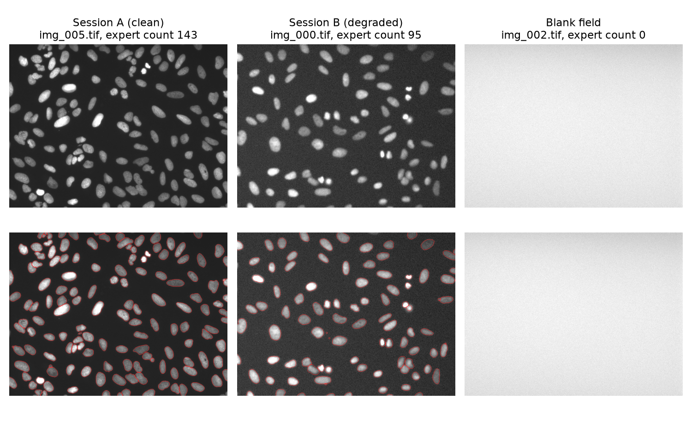
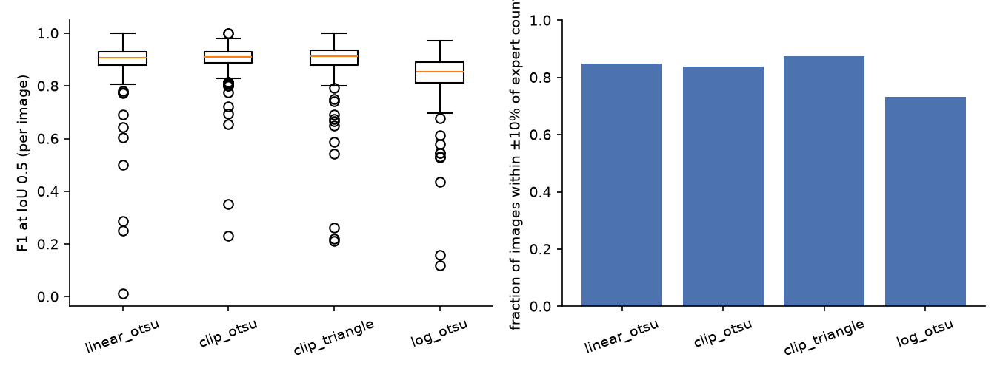
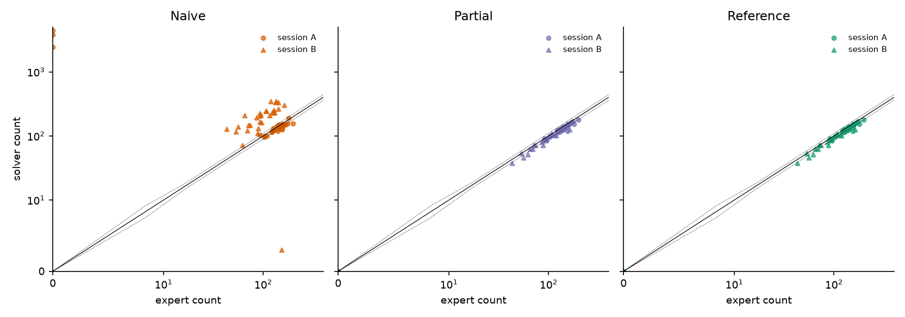
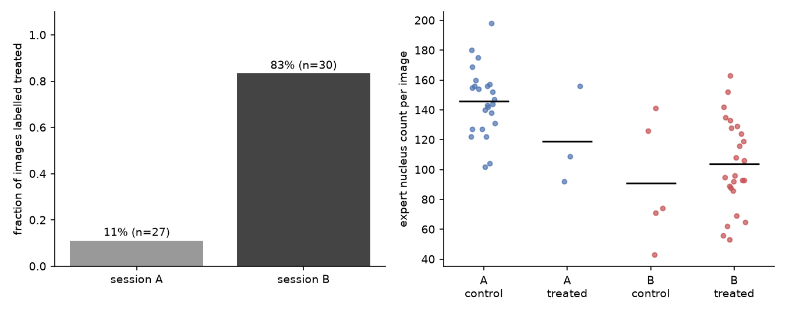
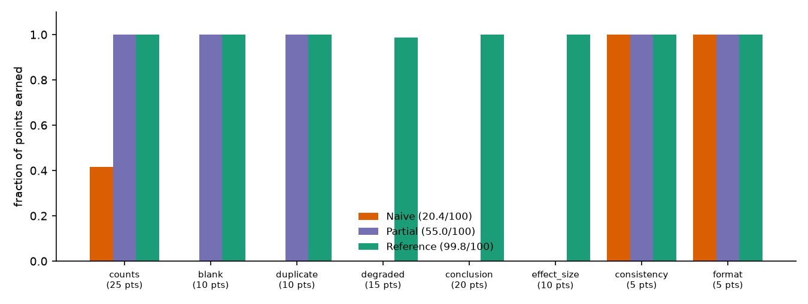
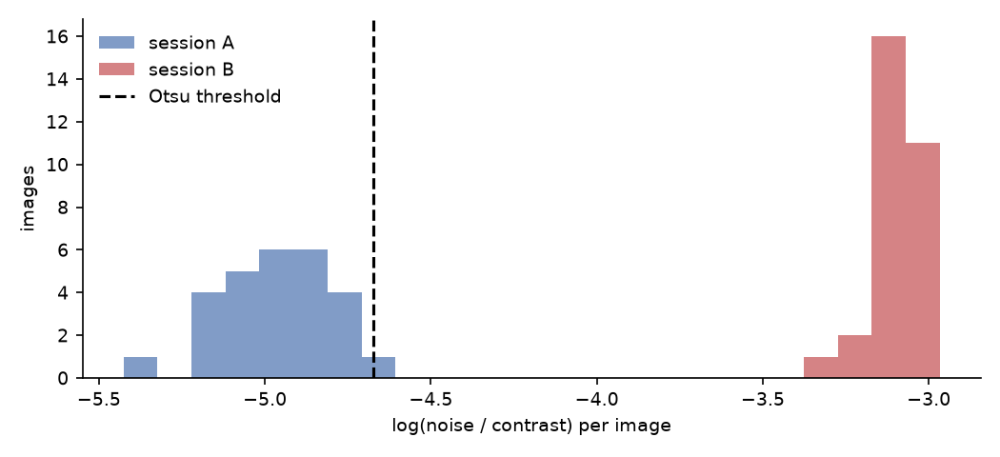

# Confounded nuclei imaging screen: an evaluation task for AI agents

*A reproducible, self-checking task that tests whether an AI agent analyses microscopy data carefully, not just quickly.*

**Status (26 Nov 2026):** task, expert solution and automatic grader are complete and have been validated against three reference solvers. Testing with real AI agents and a container (Docker) run are **not done yet**. See [Limitations](#10-limitations).

## Contents

1. [Why this task exists](#1-why-this-task-exists)
2. [The task, as the agent sees it](#2-the-task-as-the-agent-sees-it)
3. [How the data are built](#3-how-the-data-are-built)
4. [The expert solution](#4-the-expert-solution)
5. [The grader](#5-the-grader)
6. [Results and figures](#6-results-and-figures)
7. [Reproducing everything](#7-reproducing-everything)
8. [Repository layout](#8-repository-layout)
9. [Design log: what went wrong and what I changed](#9-design-log-what-went-wrong-and-what-i-changed)
10. [Limitations](#10-limitations)
11. [Conclusion](#11-conclusion)
12. [Data, licence and how to cite](#12-data-licence-and-how-to-cite)
13. [References](#13-references)

## Summary

This repository holds **one complete evaluation task** for AI agents in computational biology: the data, the instructions, an expert solution, and an automatic grader that scores any answer out of 100.

**The scenario.** An agent receives 61 fluorescence microscope images of cell nuclei, each labelled "control" or "treated". It must count the nuclei in every image and decide whether the treatment changes the number of nuclei per image.

**The catch.** The data hide several problems that a quick analysis will not notice: 3 blank images with no cells, 1 duplicated image, and 30 images that were taken under a degraded imaging condition. Those 30 images also happen to contain fewer cells and are mostly labelled "treated". A straightforward analysis therefore reports a treatment effect that is really an imaging artefact, in other words a **confounder**. The true treatment effect is none by construction.

**The ground truth.** Nucleus counts come from about 23,000 nuclei outlined by human experts in the public BBBC039 dataset. No pipeline output is used as truth.

**What was shown.** Three reference solvers of increasing care score **20.4**, **55.0** and **99.8** out of 100. The middle one counts nuclei well but ignores the imaging artefact, and it reports a drop of 29.8 nuclei per image (p < 0.001) that the treatment did not cause. That is the behaviour the task is built to catch.

**What was not shown.** No real AI agent has attempted the task yet, so there is no pass rate. The imaging artefact is simulated, so the task is **semi-synthetic**. The container run is unverified.

| Key facts | Value |
|---|---|
| Files given to the agent | 61 images + `metadata.csv` |
| Composition | 57 unique real images, 3 blank fields, 1 exact duplicate |
| Images with the simulated imaging artefact | 30 |
| Ground truth | expert outlines, BBBC039 (CC0 licence) |
| Reference-solver scores | naive 20.4, partial 55.0, expert 99.8 (out of 100) |
| Expert segmentation, median F1 at IoU 0.5 (197 non-blank images) | 0.91 (naive baseline: 0.77) |

## Key terms in plain words

| Term | Meaning |
|---|---|
| Nucleus | The compartment of a cell that holds its DNA. A DNA stain (here Hoechst) makes it glow in a fluorescence image. |
| Segmentation | Finding each object, here each nucleus, in an image and drawing its outline. |
| Ground truth | The known-correct answer, here human-drawn outlines. |
| Confounder / batch effect | A hidden factor, such as a different imaging day, that is mixed up with the thing you are testing. It can create an effect that is not real. |
| p-value | How surprising the data would be if there were really no effect. A small value (below 0.05 by convention) suggests an effect. It does not measure the size of an effect. |
| IoU | Overlap between a predicted and a true outline: the shared area divided by the combined area. 1 is perfect, 0 is no overlap. |
| F1 score | One number that balances finding all true objects (recall) against not inventing false ones (precision). Here an object counts as found if its IoU with a true nucleus is above 0.5. |
| Ablation | Removing one ingredient of a solution, to see whether that ingredient matters. |
| Semi-synthetic | Real data plus a designed, simulated component. |

## 1. Why this task exists

AI agents are increasingly asked to run multi-step scientific analyses. A good test for them is not "can you run a script", but "do you notice when the obvious script is wrong". Imaging screens are full of such traps. Samples that were imaged on different days or machines can differ in ways that look like a biological effect, a well-known problem in high-throughput biology [5], and an effect that appears in pooled data can vanish once the groups are separated (Simpson's paradox [6]).

This repository is a worked example of designing such a task end to end: choose real data with trustworthy ground truth, build hidden but realistic traps, write an expert solution, write an objective grader, and then check that the grader separates careful from careless solutions.

## 2. The task, as the agent sees it

The agent gets `instructions.md` and a `data/` folder. It gets nothing else and has no internet.

| Given | Description |
|---|---|
| `data/img_000.tif` and others | 61 fluorescence images, 16-bit TIFF, 520 x 696 pixels |
| `data/metadata.csv` | columns `file`, `condition` (control or treated), `plate` |

**Question:** does the treatment change the number of nuclei per image?

| Deliverable | Content |
|---|---|
| `results.csv` | `file`, `n_nuclei` for every image |
| `qc_flags.csv` | images that must be excluded, with a flag (`blank`, `duplicate`, `other`) and a reason |
| `summary.json` | `mean_control`, `mean_treated`, `diff`, `p_value`, `ci95`, `effect_is_real`, `degraded_files` |
| `report.md` | short explanation of the method and any technical issue found |

Allowed tools: Python with numpy, pandas, scipy, scikit-image and tifffile.

The imaging sessions are **not** labelled anywhere. If the agent wants to account for them, it has to find them from the pixels.

## 3. How the data are built

### 3.1 Source data

[BBBC039](https://bbbc.broadinstitute.org/BBBC039) [2]: 200 fields of U2OS cell nuclei stained with Hoechst, one field per chemical compound, DNA channel only, 520 x 696 pixels, 16-bit TIFF. It is a sample of the larger BBBC022 chemical screen. About 23,000 nuclei were outlined by hand [1]. Touching nuclei have different labels in the masks. The licence is CC0.

Three of the 200 images contain no nuclei at all (the expert masks are empty). They are kept on purpose, because blank fields are a realistic trap.

### 3.2 Construction steps (`scripts/make_task.py`, fixed seed)

1. Take the 3 blank fields plus 57 randomly chosen non-blank images (60 in total), in random order.
2. Rank the 57 non-blank images by their expert nucleus count (plus a little random noise). The 30 images with the **lowest** counts become **session B**. The rest, and all blank fields, are **session A**.
3. Degrade every session B image: a left-to-right brightness gradient (0.7x to 1.1x, direction random), a Gaussian blur (sigma 1.5), a raised background (+10% of the image's 99.5th percentile) and Gaussian noise (4% of that percentile).
4. Assign "control" or "treated" labels at random, with probability 0.8 of "treated" in session B and 0.2 in session A. Then **search** over random draws until the labels satisfy all of these:
   - the raw difference in expert counts is significant (p < 0.01) and clearly negative (below -25 nuclei per image),
   - after adjusting for session, the difference is small (absolute value below 10) and not significant (p > 0.2),
   - a solver with accurate counts that ignores sessions is also fooled (p < 0.01).
5. Add one pixel-identical copy of a session A image under a new name.
6. Rename all files (`img_000.tif` and so on). The plate column keeps the real BBBC022 plate IDs.

Result: 61 files = 57 unique real + 3 blank + 1 duplicate.

### 3.3 The traps

| Trap | Origin | What a careless pipeline does |
|---|---|---|
| 3 blank fields | real (BBBC039) | counts thousands of "nuclei" in background noise (the plain global-threshold baseline finds about 2,400 to 4,400 objects in each) |
| 1 exact duplicate | constructed | counts the same image twice |
| 30 degraded images | constructed | overcounts them: noise and a raised background are read as nuclei |
| Session tied to treatment labels and to true cell density | constructed | reports a significant treatment effect that is not real |
| Very different brightness between images | real | fixed intensity thresholds fail |
| Bright debris in some images | real | one bright blob dominates the intensity scaling |

### 3.4 The true answer

The treatment has no effect by construction. The raw difference in expert counts looks significant only because session and condition are mixed up. After adjusting for session, the expert counts show no effect (adjusted p > 0.2). The exact values for the built task are in [docs/RESULTS.md](docs/RESULTS.md).

## 4. The expert solution

`task_build/solution.py` (packaged as a self-contained script in `release/hidden/`). It uses only what the agent sees.

1. **Blank-field gate.** Contrast = 99.5th percentile minus median intensity. Below 200, the image is reported as blank with 0 nuclei. In the source data the three blank fields have contrast 14 to 17, and the lowest non-blank image has 513.
2. **Counting nuclei.** Subtract the median, clip at the 99th percentile (so bright debris cannot dominate), smooth, subtract a heavily blurred copy as background, apply Otsu's threshold [3], fill holes, drop objects of 29 pixels or fewer, then split touching nuclei with a distance-transform watershed [4].
3. **Duplicates.** Identical SHA-256 hash of the pixel data.
4. **Degraded images.** For each image estimate noise (robust median-absolute-deviation of a high-pass copy) and divide by contrast. Take the log, then split the images into two groups with Otsu's threshold. No labels are used.
5. **Effect estimate.** Ordinary least squares of nuclei count on condition plus a degraded-group indicator, over images that are neither blank nor duplicate. The condition coefficient is the adjusted effect, with a t-based 95% confidence interval. The effect is called real if p < 0.05.

The counting method was chosen by comparing four variants on all 197 non-blank images (Figure 2, table below). Otsu followed by watershed is a standard strategy for nucleus segmentation [1].

| Variant | n | Within 10% of expert count | Median F1 | Mean F1 | Images with F1 below 0.5 |
|---|---|---|---|---|---|
| clip + Otsu (chosen) | 197 | 0.838 | 0.910 | 0.897 | 2 |
| clip + triangle threshold | 197 | 0.873 | 0.914 | 0.890 | 3 |
| linear + Otsu | 197 | 0.848 | 0.907 | 0.887 | 3 |
| log + Otsu | 197 | 0.731 | 0.853 | 0.833 | 3 |

The first three are close, and differences of one to three points are within noise at this sample size.

## 5. The grader

`scripts/grader.py` scores any set of outputs from 0 to 100 using the hidden answer key.

| Check | Points | Rule |
|---|---|---|
| Counts | 25 | within 10% of the expert count; blank fields must be 0; full points once 75% of images are within tolerance |
| Blank flags | 10 | F1 of flagged blanks against the true blanks |
| Duplicate | 10 | exactly one image of the duplicate pair flagged and nothing else flagged as duplicate (5 points for a partial overlap) |
| Degraded group | 15 | F1 of the reported degraded images against the truly degraded ones |
| Conclusion | 20 | "no real effect", awarded **only if the effect estimate is also correct** |
| Effect size | 10 | estimated difference within 15 nuclei per image of the true session-adjusted difference |
| Consistency | 5 | the confidence interval contains the estimate and agrees with the p-value |
| Format | 5 | all required keys and files are present, one result row per image |

Design choices:
- **Partial credit and tolerances**, because different valid methods give slightly different counts.
- **No exact p-value matching.** A solver's p-value differs from the one computed on expert counts, simply because counts carry small errors. The grader checks the size of the effect and the conclusion.
- **The conclusion is gated on the estimate.** In early versions a careless solver earned the conclusion points by luck (its errors happened to cancel), so the conclusion now counts only together with a correct effect size.

## 6. Results and figures

All tables and figures below are generated by `scripts/09_make_figures.py` from the build artefacts. The full set of tables is in [docs/RESULTS.md](docs/RESULTS.md).

### 6.1 Three reference solvers

| Solver | Score | What it does |
|---|---|---|
| Expert (`task_build/solution.py`) | **99.8** | everything in section 4 |
| Partial (`scripts/ablation_partial.py`) | **55.0** | the expert's counts, with blanks and the duplicate removed, but no handling of the imaging artefact |
| Naive (`scripts/naive_solution.py`) | **20.4** | global Otsu threshold on the raw images, no quality control, plain Welch t-test [7] |

The partial solver is an ablation. An early version of the task let it score 85, because accurate counts alone were enough to get the right answer. The task was redesigned so that session also changes the true counts. Now the partial solver reports a difference of -29.8 nuclei per image with p < 0.001, loses the conclusion and effect-size points, and scores 55.

### 6.2 Segmentation accuracy on BBBC039

| Method | Images | Median count error | Within 10% | Median F1 at IoU 0.5 |
|---|---|---|---|---|
| Expert method | 197 | 5.0% | 83.8% | 0.91 |
| Naive baseline | 197 | 7.3% | 65.0% | 0.77 |
| Expert method, test split only | 50 | 6.2% | 82.0% | 0.91 |
| Naive baseline, test split only | 50 | 7.7% | 62.0% | 0.77 |

The expert method also reports all 3 blank fields as empty, while the naive baseline reports none of them as empty. The "test split" is the held-out list shipped with BBBC039, but the method was chosen using all images, so this is only a weak independent check.

### 6.3 A negative result: plates carry no batch effect

I first assumed the real plate IDs would give a natural batch effect to build on. They do not: across 20 plates, a one-way ANOVA on expert counts gives F = 1.08, p = 0.375, and plate explains 10% of the variance, which is about what pure chance gives with this many groups. So the confound was built from a simulated imaging session instead (section 3.2).

### 6.4 Figures

**Figure 1. Example images.**

Top row: raw images. Bottom row: the same images with the expert outlines in red. Left: a clean session A image. Middle: a degraded session B image (blurrier, with a brighter background and more grain). Right: a blank field, which looks like grey haze with no nuclei.

**Figure 2. Choosing the counting method.**

Left: spread of per-image F1 for four preprocessing and threshold variants. Right: share of images whose count is within 10% of the expert count. The log-transform variant is clearly worse. The other three are close, and clip + Otsu was kept because it had the best mean F1 and the fewest failures.

**Figure 3. Solver counts against expert counts.**

Each dot is one image. The diagonal is a perfect count and the dotted lines mark plus and minus 10%. The expert method sits close to the diagonal in both sessions. The naive baseline shoots far above it on degraded images and on blank fields. The partial solver reuses the expert's counts, so its panel is identical to the expert's by design.

**Figure 4. The confounder.**

Left: the share of images labelled "treated" in each session. Right: expert nucleus counts by session and condition (dots are images, bars are group means). Treated images are mostly in session B, and session B has fewer nuclei, so "treated" looks lower even though the labels have no biological meaning.

**Figure 5. Estimated treatment effect for each solver.**

Each point is a solver's estimated difference (treated minus control) with its 95% confidence interval. The green dashed line is the effect computed from expert counts after adjusting for session, and the dotted line is the unadjusted difference from the same counts. The expert solution lands within 15 nuclei per image of the green line. The partial and naive solvers do not, and earn 0 effect-size points.

**Figure 6. Where each solver earns its points.**

Fraction of the available points earned per grader check. The expert solution earns nearly everything. The partial solver loses the degraded-group, conclusion and effect-size points, and the naive solver loses most checks.

**Figure 7. Finding the degraded images from pixels alone.**

Histogram of log(noise divided by contrast) for every real image. Session B images (red) sit to the right of session A images (blue), and the dashed line is an unsupervised Otsu threshold that needs no labels. This is how the expert solution recovers the hidden group (it earns 14.8 of 15 points for the degraded group). The exact detection accuracy is in [docs/RESULTS.md](docs/RESULTS.md).

## 7. Reproducing everything

Run all commands from the repository root. The software versions used were Python 3.14, numpy 2.5.5, pandas 3.1.1, scipy 1.18.1, scikit-image 0.26.0 and tifffile 2026.11.16.

    python -m venv .venv && source .venv/bin/activate
    pip install -r requirements.txt

    python scripts/00_prepare_data.py       # download BBBC039 (about 80 MB), prepare metadata
    python scripts/05_compare_methods.py    # segmentation variants (needed for Figure 2)
    python scripts/06_ref_vs_naive.py       # expert vs naive segmentation table
    python scripts/make_task.py             # build task_build/data and the hidden answer key
    python task_build/solution.py           # expert outputs
    python scripts/naive_solution.py        # naive outputs
    python scripts/ablation_partial.py      # partial outputs
    python scripts/grader.py task_build/output_ref
    python scripts/09_make_figures.py       # figures and docs/RESULTS.md
    python scripts/package_task.py          # release/: agent-visible task + hidden files

`release/task/` holds only what an agent may see. `release/hidden/` holds the answer key, a self-contained expert solution and the grader. Neither folder is committed to this repository.

To test an agent: copy `release/task/instructions.md` and `release/task/data` into a fresh folder, let the agent work there, then run `python release/hidden/grader.py <that folder>/output`.

## 8. Repository layout

    scripts/00_prepare_data.py    download and prepare BBBC039
    scripts/01 to 08              exploration and feasibility experiments (kept as a design log)
    scripts/09_make_figures.py    figures and generated tables
    scripts/common.py             loading and metric utilities
    scripts/ref_method.py         expert and naive segmentation
    scripts/make_task.py          task generator
    scripts/grader.py             automatic grader
    scripts/package_task.py       builds the self-contained release folder
    scripts/naive_solution.py     naive reference solver
    scripts/ablation_partial.py   partial reference solver
    task_build/instructions.md    the text the agent sees
    task_build/solution.py        expert solution
    docs/RESULTS.md               generated tables
    docs/figures/                 generated figures

## 9. Design log: what went wrong and what I changed

1. **Plates had no batch effect** (section 6.3). I tested this before building on it, then created the imaging-session artefact instead.
2. **A log transform made counting worse** (73% within tolerance against 84%), so intensity clipping was used instead (Figure 2).
3. **The first confound was too weak.** A solver with accurate counts but no session handling scored 85, because session changed the image quality but not the true counts. I made session also determine true cell density, which dropped that solver to 55.
4. **A careless solver got the conclusion right by luck**, twice. Its errors cancelled out, so it said "no effect" without a correct estimate. The conclusion is now gated on the effect size.
5. **The first task builder did not check that the careless pipeline was actually fooled** for the chosen labels. It now searches for label assignments where it is.

## 10. Limitations

- **Semi-synthetic.** The imaging artefact, its link to cell density and the treatment labels are my design choices, not a measured experiment. The images, counts and ground truth are real.
- **No agent has attempted the task yet,** so there is no pass rate and nothing shows that modern agents find it hard. This is the main open item.
- **The validation is partly circular.** I developed the grader and the expert solution together, so 99.8 is not independent evidence. The ladder of 20.4, 55.0 and 99.8 shows that the grader separates degrees of care, not that the task is difficult.
- **The labels were selected** (a search over random assignments) so that the trap is active. This is common practice in benchmarks but should be stated.
- **Tolerances are first estimates.** The effect-size tolerance (15 nuclei per image) is only about half the size of the artefact effect the trap produces (roughly 30). The margin is not validated against agent runs.
- **The blank-field rule is based on three examples,** which are all separated from real images by a large gap (contrast 14 to 17 against 513 or more), but three is a small number.
- **Method choice and evaluation use the same images,** apart from the weak held-out check in section 6.2.
- **The container build is untested.** `package_task.py` writes a Dockerfile, but I have not built or run it, so the "runs offline in a container" claim is unverified.
- **One task only.** The expert solution and grader are public here, so this is a demonstration, not a secure benchmark item.

## 11. Conclusion

This repository shows one full cycle of designing an agent evaluation task: real data with human ground truth, hidden but realistic traps, an expert solution that finds them from the pixels alone, and an automatic grader that rewards the whole chain of reasoning and not just a final number. The central design lesson is that accurate measurement is not enough. A solver can count nuclei very well and still reach the wrong scientific conclusion if it does not notice what is confounded with the treatment, and the three reference solvers (20.4, 55.0, 99.8) show that the grader can tell these apart.

Equally important is what has not been shown. No AI agent has been run on the task, the container build is unverified, and the confound is simulated. Next steps, in order: run three to five fresh agent attempts and record scores and failure modes, calibrate the grader's tolerances against them, build and run the container with networking disabled, and extend the same design to other data types (for example sequencing counts).

## 12. Data, licence and how to cite

- **Images and masks:** BBBC039 [2], CC0. Not redistributed here. `scripts/00_prepare_data.py` downloads them from the Broad Bioimage Benchmark Collection.
- **Code and documentation:** MIT licence.
- **If you use BBBC039,** the collection asks for this citation: Caicedo et al. 2018 (the preprint of [1]), with the BBBC collection paper [2].

Author: Mahmudul Hasan Marjuk, Industrial and Production Engineering, Shahjalal University of Science and Technology (SUST), Sylhet, Bangladesh.

## 13. References

1. Caicedo JC, Roth J, Goodman A, Becker T, Karhohs KW, Broisin M, Molnar C, McQuin C, Singh S, Theis FJ, Carpenter AE. Evaluation of deep learning strategies for nucleus segmentation in fluorescence images. *Cytometry Part A*. 2019;95(9):952-965. doi:10.1002/cyto.a.23863 (preprint: bioRxiv, 2018, doi:10.1101/335216).
2. Ljosa V, Sokolnicki KL, Carpenter AE. Annotated high-throughput microscopy image sets for validation. *Nature Methods*. 2012;9(7):637. doi:10.1038/nmeth.2083. Image set BBBC039: https://bbbc.broadinstitute.org/BBBC039
3. Otsu N. A threshold selection method from gray-level histograms. *IEEE Transactions on Systems, Man, and Cybernetics*. 1979;9(1):62-66. doi:10.1109/TSMC.1979.4310076
4. Vincent L, Soille P. Watersheds in digital spaces: an efficient algorithm based on immersion simulations. *IEEE Transactions on Pattern Analysis and Machine Intelligence*. 1991;13(6):583-598. doi:10.1109/34.87344
5. Leek JT, Scharpf RB, Bravo HC, et al. Tackling the widespread and critical impact of batch effects in high-throughput data. *Nature Reviews Genetics*. 2010;11:733-739. doi:10.1038/nrg2825
6. Simpson EH. The interpretation of interaction in contingency tables. *Journal of the Royal Statistical Society, Series B*. 1951;13(2):238-241.
7. Welch BL. The generalization of "Student's" problem when several different population variances are involved. *Biometrika*. 1947;34(1-2):28-35. doi:10.1093/biomet/34.1-2.28
8. van der Walt S, Schonberger JL, Nunez-Iglesias J, et al. scikit-image: image processing in Python. *PeerJ*. 2014;2:e453. doi:10.7717/peerj.453
9. Virtanen P, Gommers R, Oliphant TE, et al. SciPy 1.0: fundamental algorithms for scientific computing in Python. *Nature Methods*. 2020;17:261-272. doi:10.1038/s41592-019-0686-2
10. Harris CR, Millman KJ, van der Walt SJ, et al. Array programming with NumPy. *Nature*. 2020;585:357-362. doi:10.1038/s41586-020-2649-2
11. McKinney W. Data structures for statistical computing in Python. *Proceedings of the 9th Python in Science Conference*. 2010:56-61.
12. Hunter JD. Matplotlib: a 2D graphics environment. *Computing in Science & Engineering*. 2007;9(3):90-95. doi:10.1109/MCSE.2007.55
