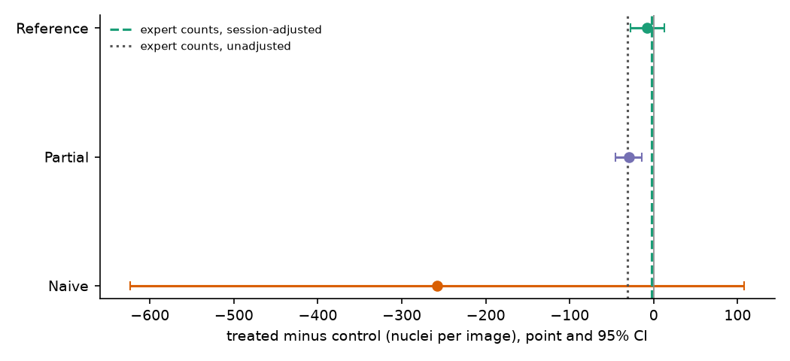

# Bioimage agentic task benchmark: confounded nuclei imaging screen

A multi-step computational life-science task for evaluating AI agents, with a reference
solution, an automated grader, and verified ground truth. Built from real public
microscopy data (BBBC039, CC0).

**Status:** task, reference solution and grader are complete and validated against three
solvers. Testing with real AI agents and an offline Docker run are still pending (see
Limitations).

## The task

An agent receives 61 fluorescence images of Hoechst-stained U2OS nuclei (16-bit TIFF) and a
`metadata.csv` (file, condition, plate). Question: **does the treatment change the number
of nuclei per image?** The agent must write `results.csv` (nuclei per image), `qc_flags.csv`,
`summary.json` (means, difference, p-value, 95% CI, conclusion, degraded files) and
`report.md`. No internet, Python only.

## Why it is hard

The obvious pipeline gives a confidently wrong answer. The data contain hidden traps:

| Trap | Origin | What a careless pipeline does |
|---|---|---|
| 3 blank fields (no nuclei) | real, from BBBC039 | reports hundreds of nuclei in background noise |
| 1 exact duplicate image | constructed | double-counts it |
| Imaging-session artifact (illumination ramp, blur, raised background, noise) on 30 images | constructed, seeded | overcounts degraded images |
| Session is confounded with condition and with true nucleus density | constructed | finds a fake, significant treatment effect |
| Brightness differs widely between images | real | fixed thresholds fail |

The sessions are **not** labelled in the metadata. The agent has to find the degraded group
from the images themselves, then adjust for it. The true treatment effect is null by
construction.

## Ground truth

Nucleus counts come from the BBBC039 expert masks (about 23,000 hand-annotated nuclei),
never from a pipeline. The true adjusted treatment effect is computed from those counts.

## Grader (100 points, partial credit)

| Check | Points | Rule |
|---|---|---|
| Counts | 25 | within 10% of the expert count; blank fields must be 0; full marks at 75% of images |
| Blank flags | 10 | F1 against the true blank fields |
| Duplicate | 10 | exactly one image of the pair flagged |
| Degraded group | 15 | F1 against the true degraded images |
| Conclusion | 20 | "no real effect", **only awarded if the effect estimate is also correct** |
| Effect size | 10 | difference within 15 nuclei/image of the true adjusted effect |
| Consistency | 5 | CI contains the estimate and agrees with the p-value |
| Format | 5 | all required keys and files present |

The conclusion is gated on the estimate so that a solver cannot get it right by accident.
This was added after a naive solver earned those points by luck.

## Validation with reference solvers

| Solver | Score | What it represents |
|---|---|---|
| Reference (`task_build/solution.py`) | 99.8 | clips intensities, background-corrects, thresholds, splits touching nuclei, flags blanks and duplicate, detects the degraded group, adjusts for it |
| Partial (`scripts/ablation_partial.py`) | 55.0 | counts well and removes blanks/duplicate, but never notices the session artifact |
| Naive (`scripts/naive_solution.py`) | 20.4 | global Otsu on raw images, plain t-test |

The partial solver exists because an earlier version of the task let it score 85: good
counts alone were enough. The task was changed so that session also changes the true
counts, which made it a real confounder.

Segmentation quality on all 197 non-blank BBBC039 images (F1 at IoU 0.5, median):
reference 0.91, naive 0.77.

## Results

Full tables and all figures: [docs/RESULTS.md](docs/RESULTS.md) (generated by
`scripts/09_make_figures.py` from the build artifacts, not typed by hand).

**Figure 1.** Top: raw images (each panel scaled to its own 99.5th percentile). Bottom:
the same images with BBBC039 expert outlines in red. Left to right: a clean session A image,
a degraded session B image, and a blank field.

**Figure 2.** The confound. Left: treated labels are concentrated in session B. Right: expert
nucleus counts by session and condition (horizontal bars are group means). Session B images
have lower true counts, so treated looks lower even though no effect was built in.

**Figure 3.** Estimated treatment effect with 95% CI for each solver. The dashed green line
is the effect computed from expert counts with session adjustment; the dotted line is the
unadjusted difference from the same expert counts.

**Figure 4.** Share of available points earned per grader check by each solver.

## How the task is built

Reproducible from a fixed seed (`SEED` in `scripts/make_task.py`).

    pip install -r requirements.txt
    python scripts/00_prepare_data.py     # download BBBC039, prepare metadata
    python scripts/make_task.py           # build task_build/data and ground truth
    python task_build/solution.py         # reference outputs
    python scripts/naive_solution.py      # naive outputs
    python scripts/ablation_partial.py    # partial outputs
    python scripts/grader.py task_build/output_ref
    python scripts/package_task.py        # release/: agent-visible task + hidden files

`release/task/` holds only what an agent may see. `release/hidden/` holds the answer key,
the self-contained expert solution and the grader. Neither is committed to this repo.

## Repository layout

    scripts/00_prepare_data.py    data download and preparation
    scripts/01-08_*.py            exploration and feasibility experiments (kept as a design log)
    scripts/common.py             loading and metric utilities
    scripts/ref_method.py         reference and naive segmentation
    scripts/make_task.py          task generator (hidden seed)
    scripts/grader.py             automated grader
    scripts/package_task.py       builds the self-contained release folder
    task_build/instructions.md    the text the agent sees
    task_build/solution.py        expert solution

## Design log (what was tested and changed)

- Checked whether BBBC039 plates carry a real batch effect in nucleus counts: they do not
  (ANOVA p = 0.375), so the confound was built from an imaging-session artifact instead.
- First confound design was too weak: a solver with accurate counts still passed. Session
  was redefined to also determine true nucleus density.
- The label assignment is searched so that the confound is active (raw effect significant
  and false, adjusted effect null, a solver with good counts but no session handling is
  also fooled).

## Limitations

- **Semi-synthetic.** The imaging-session artifact and its link to nucleus density are
  constructed design assumptions, not a measured experiment. Images, counts and ground
  truth are real.
- **The label assignment is selected** to make the trap fire. This is common in benchmarks
  but should be stated.
- **Validation is partly circular.** The grader and the reference solver were developed
  together, so the 99.8 is not independent evidence. The solver ladder (20.4, 55.0, 99.8)
  shows the grader separates solution quality, not that the task is hard for modern agents.
- **Not yet tested with real AI agents**, so there is no pass rate. This is the main open
  item.
- **Offline Docker run not yet verified.** A Dockerfile is generated by `package_task.py`.
- The blank-field rule (contrast below 200) is based on only 3 blank images.
- Grader tolerances are first estimates and have not been calibrated against agent runs.
- Single task; the reference solution is public here, so this task is a demonstration, not
  a secure benchmark item.

## Data and licence

Images and masks: BBBC039, CC0. Not redistributed in this repository; downloaded by
`scripts/00_prepare_data.py`. Code: MIT.

Citations:
- Caicedo et al., Nature Methods, 2019, doi:10.1038/s41592-019-0612-7
- Ljosa et al., Nature Methods, 2012, doi:10.1038/nmeth.2083

Author: Mahmudul Hasan Marjuk (SUST, Industrial & Production Engineering).
