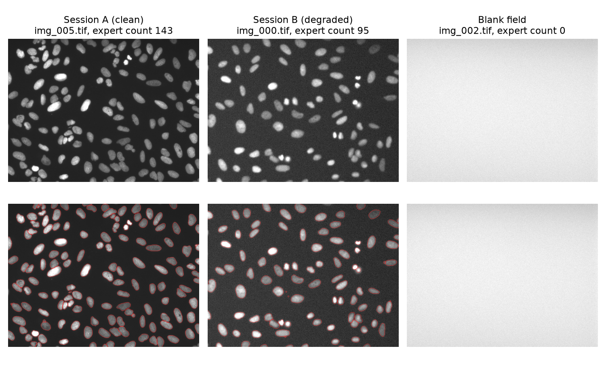
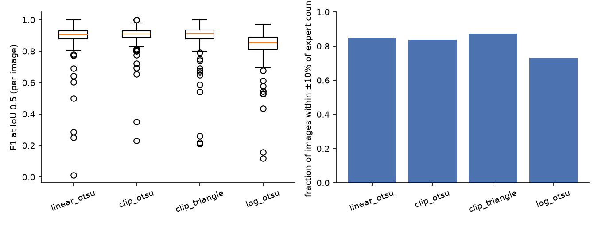
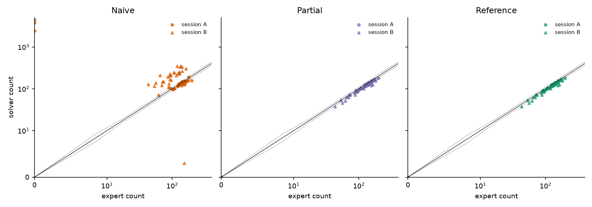
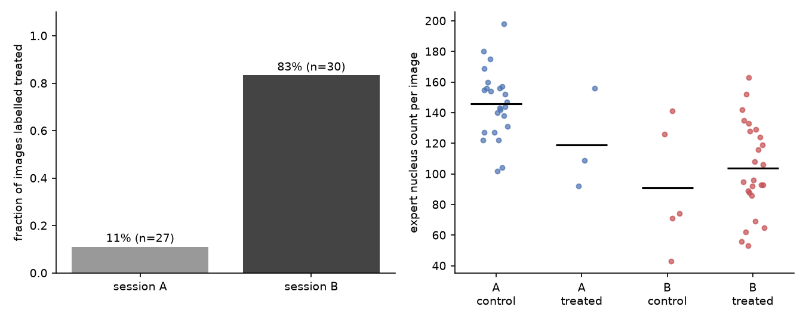
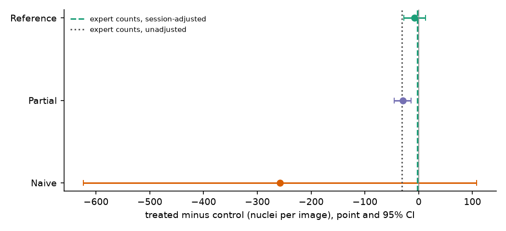
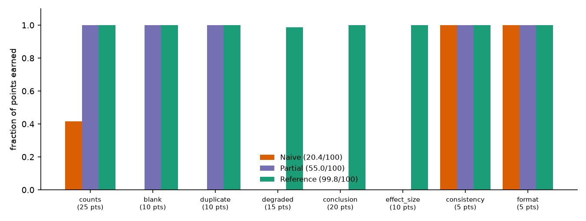
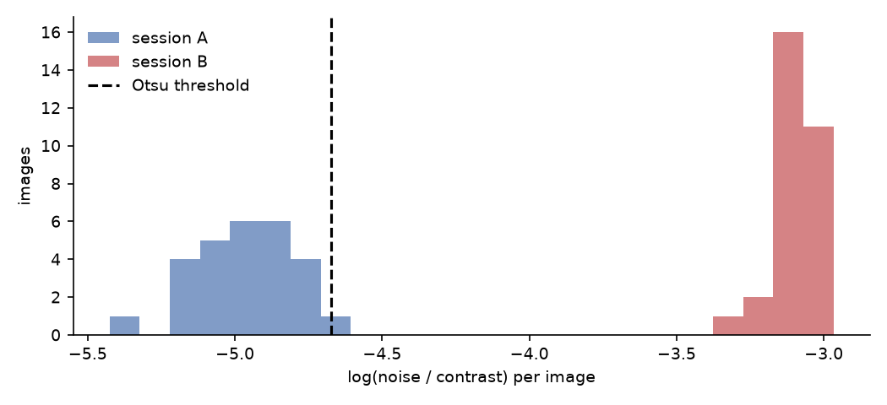

# Results

_Generated by `scripts/09_make_figures.py`. Do not edit by hand._

## Task composition

| composition | value |
|---|---|
| files given to the agent | 61 |
| unique real images | 57 |
| blank fields | 3 |
| exact duplicates | 1 |
| session A (real images) | 27 |
| session B (real images) | 30 |
| treated / control (real images) | 28 / 29 |
| treated fraction in session A | 0.11 |
| treated fraction in session B | 0.83 |

## Grader scores by solver

| check (max points) | Naive | Partial | Reference |
|---|---|---|---|
| counts (25) | 10.4 | 25.0 | 25.0 |
| blank (10) | 0.0 | 10.0 | 10.0 |
| duplicate (10) | 0.0 | 10.0 | 10.0 |
| degraded (15) | 0.0 | 0.0 | 14.8 |
| conclusion (20) | 0.0 | 0.0 | 20.0 |
| effect_size (10) | 0.0 | 0.0 | 10.0 |
| consistency (5) | 5.0 | 5.0 | 5.0 |
| format (5) | 5.0 | 5.0 | 5.0 |
| TOTAL (100) | 20.4 | 55.0 | 99.8 |

## Treatment-effect estimates

| analysis | diff | ci95 | p | says_effect_real |
|---|---|---|---|---|
| expert counts, unadjusted | -31.1 | - | 0.0005 | - |
| expert counts, session-adjusted (ground truth) | -2.8 | - | 0.804 | False |
| Naive solver | -257.8 | [-623.2, 107.7] | 0.1606 | False |
| Partial solver | -29.8 | [-45.4, -14.1] | 0.0003 | True |
| Reference solver | -7.6 | [-27.5, 12.4] | 0.4488 | False |

## Artifact detection

The noise-to-contrast feature with an Otsu threshold classifies 98.2% of the 57 real images into the correct imaging session.

## Segmentation variants (197 non-blank BBBC039 images)

| variant | n | median_F1 | mean_F1 | within_10pct | F1_below_0_5 |
|---|---|---|---|---|---|
| linear_otsu | 197 | 0.907 | 0.887 | 0.848 | 3 |
| clip_otsu | 197 | 0.91 | 0.897 | 0.838 | 2 |
| clip_triangle | 197 | 0.914 | 0.89 | 0.873 | 3 |
| log_otsu | 197 | 0.853 | 0.833 | 0.731 | 3 |

## Figures

